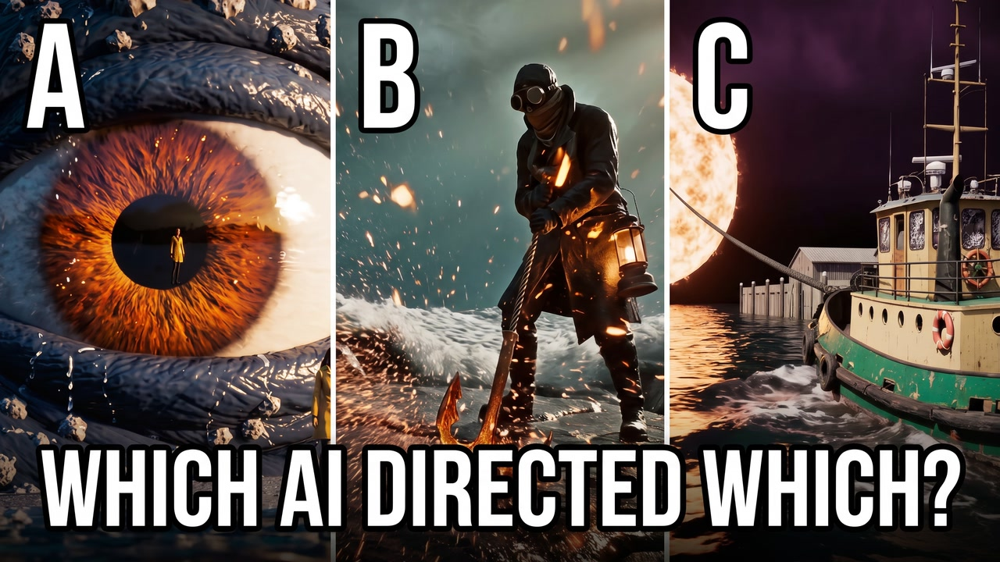
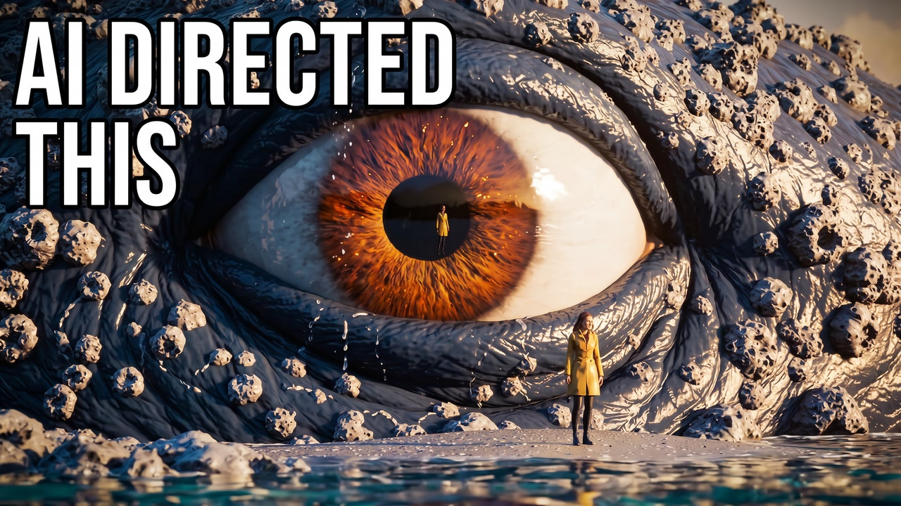
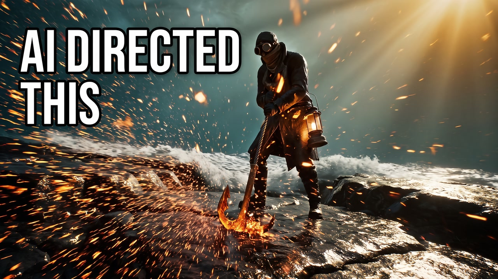
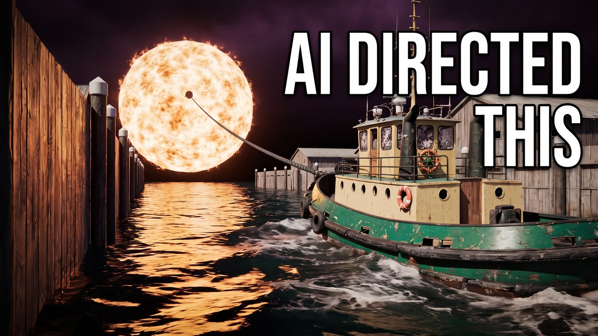
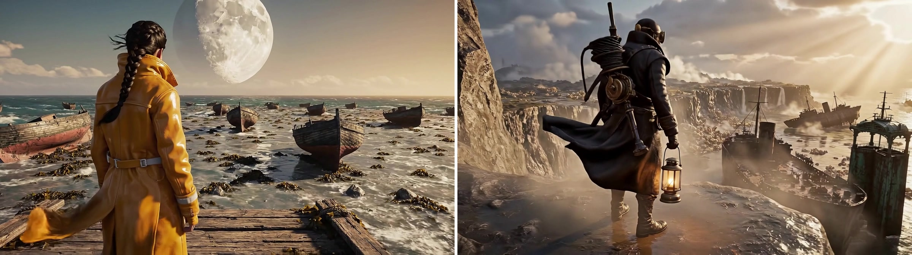

# Director's chair: Fable 5.2 vs Gemini 4 Carbon vs GPT-6.2 Astra

## 1. What this is

In GTA VI's launch week, three flagship models each invented an open-world game and directed its 30 second launch trailer.

- Fable 5.2 worked in Claude Code.
- Gemini 4 Carbon worked in Antigravity.
- GPT-6.2 Astra worked in Codex.

The author wrote the brief and the constraints, ran the production desk, and reviewed the results. The directors only wrote orders.

## 2. The trailers

Cover images were made with an image model from real trailer frames. same-premise.jpg shows unedited frames.

| Game | Director | Tagline | Price | Release date | Trailer |
|---|---|---|---|---|---|
| MOONDRAWN | Fable 5.2 | Be back before the sea is. | $59.99 | February 26, 2027 | https://youtu.be/3rj_qZRf4R4 |
| NEAPSCAR | Gemini 4 Carbon | Forty minutes of dry seabed. Then the ocean comes home. | $69.99 | December 4, 2026 | https://youtu.be/UJMxU4khXvc |
| Morrow Under Tow | GPT-6.2 Astra | Who gets the morning? | US$34.99 | 17 September 2027 | https://youtu.be/qL6d9SDU_ao |

All three trailers in one video: https://youtu.be/xzpxLuNdRxM

These games are fictional. They do not exist and there is nothing to pre-order. Each model chose its own title, tagline, price and date. See `directors/*/GAME.md`.

A 360p preview of each final cut is in `directors/*/final/`.

## 3. Rules

- One brief, one revision round, then a final cut. No credits.
- The same budget for each director:
  - 400 Flow credits for video.
  - 3,000 ElevenLabs credits for sound effects and voice.
  - 4 Flow Music attempts.
- The desk executed every order as written.
- The directors never saw moving video and never heard audio. They judged from contact sheets and measurements.

The three messages the directors received are in `briefs/`.

## 4. Budget

Taken from each director's `LEDGER.md`.

| Director | Resource | Budget | Round 1 | Round 2 | Remaining |
|---|---|---:|---:|---:|---:|
| Fable 5.2 | Flow credits | 400 | 240 | 160 | 0 |
| Fable 5.2 | ElevenLabs credits | 3,000 | 1,779 | 1,221 | 0 |
| Fable 5.2 | Flow Music attempts | 4 | 2 | 2 | 0 |
| Gemini 4 Carbon | Flow credits | 400 | 260 | 140 | 0 |
| Gemini 4 Carbon | ElevenLabs credits | 3,000 | 2,006 | 994 | 0 |
| Gemini 4 Carbon | Flow Music attempts | 4 | 3 | 1 | 0 |
| GPT-6.2 Astra | Flow credits | 400 | 280 | 120 | 0 |
| GPT-6.2 Astra | ElevenLabs credits | 3,000 | 1,687 | 1,313 | 0 |
| GPT-6.2 Astra | Flow Music attempts | 4 | 3 | 1 | 0 |

All three budgets end at zero.

## 5. Timeline

From `desk/RUNLOG.md`. Times are Istanbul time.

**Round 1, 20 Nov 2026**

- 22:49: the first message goes to all three directors.
- 22:52: GPT-6.2 Astra finishes its first orders (3m40s).
- 23:00: Fable 5.2 finishes (about 11m).
- 23:03: Gemini 4 Carbon finishes (14m).
- No director needed an intervention.

**Round 2, 21 Nov 2026**

- About 02:06: the second message goes to all three directors.
- ORDERS-2.md file times: GPT-6.2 Astra 02:08:42, Gemini 4 Carbon 02:14:49, Fable 5.2 02:15:16.
- 02:37: Fable 5.2 sends its closing message.
- 03:04 to 03:21: the desk runs ElevenLabs. Files: Fable 5.2 35, Gemini 4 Carbon 30, GPT-6.2 Astra 11.
- 03:16 to 03:52: the desk downloads 38 Flow clips with the 1080p upscale. None was refused and none was regenerated.
- Flow Music: 4 submissions, one track each.
- The ledgers are rewritten as cumulative ledgers. All budgets end at zero.

**Round 3, 21 Nov 2026: final cut**

- All three write BRIEF.md and REPORT.md with the local audio provider, at 0 credits.
- Fable 5.2 and Gemini 4 Carbon run briefcut and iterate on their renders.
- GPT-6.2 Astra writes the brief and stages the clips but never renders.
- The desk re-renders all three with briefcut 0.1.0.

## 6. Findings

**a. Two directors invented the same premise independently.**
The sea drains away. A salvager works the dry seabed. The water comes back as a wall. Both GAME.md files call that wave "the Return".
See `directors/fable-5-2/GAME.md` (feature 2) and `directors/gemini-4-carbon/GAME.md` (pitch).

*Left: MOONDRAWN (Fable 5.2). Right: NEAPSCAR (Gemini 4 Carbon). Unedited frames from the two final cuts.*

**b. No director heard its own trailer.**
All three chose the music by measurement.
See the music section of each `directors/*/REPORT.md`.

**c. Two directors rendered and iterated. One never rendered.**
Fable 5.2 and Gemini 4 Carbon rendered their own cuts and iterated.
GPT-6.2 Astra wrote the brief and never rendered. The desk rendered it unedited. It passed all QA checks on its first render.
See `directors/gpt-6-2-astra/final/REPORT.md`.
The desk re-rendered the other two and got byte-identical masters: 720 of 720 frames identical and the audio bit-identical.
See `desk/regression-fable-5-2.md`, `desk/regression-gemini-4-carbon.md` and `desk/RUNLOG.md`.

**d. Desk errors, stated openly.**

- The voice rule first picked a male voice for a female description. The four lines were regenerated at the desk's cost: 139 credits.
  See `directors/gemini-4-carbon/LEDGER.md`, round 1 desk notes.
- The voice search fallback returned three voices labelled as non-English: Russian and Hindi for Fable 5.2 in round 2, Korean for Gemini 4 Carbon in round 1.
  See the voice lists in `directors/fable-5-2/LEDGER.md` and `directors/gemini-4-carbon/LEDGER.md`.
- One clip could not be upscaled in round 1. Flow's 1080p upscale failed three times for `29_S09_BOOTS_lite.mp4`. It was delivered at 1280x720.
  See `directors/fable-5-2/LEDGER.md`, round 1 desk notes.

## 7. Could they see each other?

Two directors landed on the same premise. So the question is fair. The session transcripts show no sign of it.

**a. Separate sessions, same message.**
There were three sessions in three different vendors' tools: Claude Code, Antigravity and Codex. Each worked in its own folder. Each received the same single message. That message names no theme. It asks for an open-world game and nothing more. See `briefs/MESSAGE-1.txt`.

**b. No look at the other folders.**
No transcript contains a command that reads another director's folder or the parent folder. Every file each director read or wrote was inside its own folder, apart from its own temporary files and the public briefcut repository.

**c. Each had its premise before the other had saved anything.**
Times are Istanbul time on 20 Nov 2026.

- 22:54: Gemini 4 Carbon first writes the tide premise in its notes.
- 22:55: Gemini 4 Carbon picks the title NEAPSCAR.
- 22:56: Fable 5.2 first uses the title MOONDRAWN.
- 22:59: Fable 5.2 saves its first file with the premise.
- 23:02: Gemini 4 Carbon saves its first files.

GPT-6.2 Astra had a different premise, a sun on a tow rope. It saved its GAME.md at 22:51.

**d. The tool did not suggest it.**
All three read the briefcut documentation. It contains none of the words sea, tide, moon or ocean.

The raw transcripts are not published because they contain account ids.

## 8. Limitations

There was one run per model. Each ran in its vendor's own tool with its own settings. This is not a benchmark.

- Pixels come from Google Flow.
- Music comes from Flow Music.
- Sound comes from ElevenLabs.
- The edit comes from briefcut (https://github.com/cagrikacmaz/briefcut).

## 9. Disclosure

My agency participates in the partner programs of both Anthropic and OpenAI.

If you want to support the next experiment: https://buymeacoffee.com/cagrikacmaz
